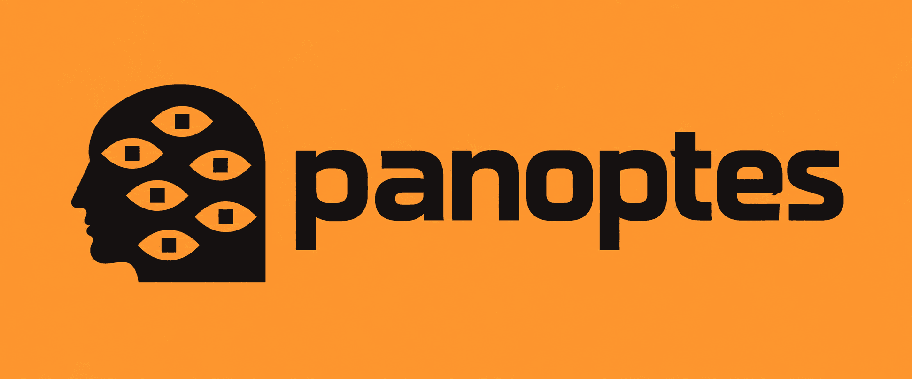
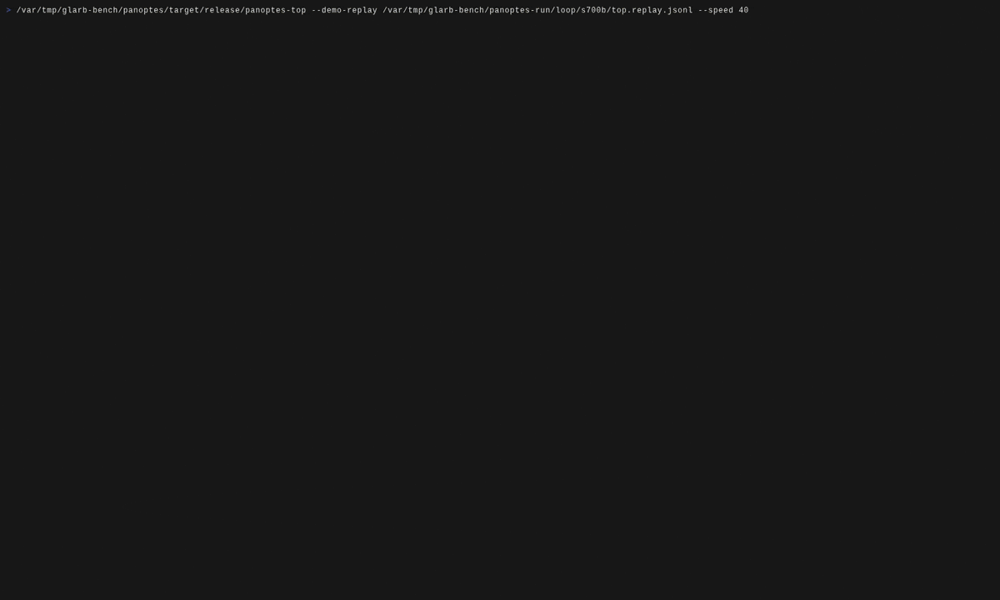

<p align="center">
  
</p>

A high-performance harness and orchestrator for graphical AI agents on
Linux.

> **Heavily a work in progress.** This README is a placeholder until v0.
> Its numbers come from the invoice demo on the earlier Chromium desk, not
> from the current Wayland desk. [docs/one-pager.md](docs/one-pager.md)
> says how each was measured.

Each agent gets its own Linux desktop: our fork of the Cage compositor at
1024x768, running whatever programs the agent launches, Wayland or X11.
We design Panoptes for fast models. We treat a model call as free and
instant, and optimize what each step costs the host: acting, waiting for
the screen to settle, and capturing it. [docs/vision.md](docs/vision.md)
explains the bet.

When an agent stops acting, Panoptes freezes its desktop with cgroup v2.
After 30 s idle, it compresses the desktop's memory into zswap with
writeback off. That pays while an agent waits on something slower than
itself: a person, a slow backend, or a quota. Measured with Chromium, a
parked desktop held about 40 MiB and took about 100 ms to wake and take a
screenshot. Native programs park too: KiCad went from 1387 to 333 MiB,
Blender from 871 to 164, and LTspice under Wine from 215 to 93.



`panoptes top` replaying the 700-agent test run at 40 times speed. Blue
boxes are parked desktops, orange ones are waiting for the model, and
green ones are acting. The model in this run is scripted; see Status.

`panoptes-desk` serves each agent's tools over MCP, in screen pixels:
screenshot and windows to look; click, move, drag, scroll, key and type to
act; launch, focus, close, kill and wait to manage programs. After each
action it waits for the screen to settle, then reports the windows that
opened, closed or took focus, with a screenshot. `panoptes-loop` drives
many agents from one process with any OpenAI-compatible model API; it
still speaks the earlier desk's browser tools, so it does not drive this
desk yet.

Status: prototype. The checks below drive Wayland and X11 apps through
the desk. The scale results come from the earlier desk, which ran Chromium
in each Cage and drove it over the Chrome DevTools Protocol: on one host
with 32 threads and 125 GiB of RAM, 700 agents entered 700 of 700 test
invoices correctly, with 670 parked at the peak. The demo's cap of 25
agents in ERPNext at once set the rate: 300 agents entered invoices as
fast as 700. That run used a scripted model that answers from the test
data after 2 s, to measure Panoptes itself; real models have run 10
invoices. [docs/one-pager.md](docs/one-pager.md) has the numbers, and
[docs/design/](docs/design/README.md) explains how each was measured.

## Layout

```text
crates/
├─ panoptes-cgroup   cgroup v2: freeze, reclaim, weights, clone3 spawn
├─ panoptes-desk     per-agent tool server over Wayland: pixels, input, windows; MCP
├─ panoptes-resd     freezes and parks agents' desktops
├─ panoptes-sync     threads, channels and locks: std's, or loom's for the models
├─ panoptes-loop     agent loop with an OpenAI-compatible model client
├─ panoptes-oracle   scripted model for scale tests
├─ panoptes-top      terminal view of every agent
└─ panoptesctl       command line
nix/                 the Cage fork's build and the end-to-end checks
demo/                invoice-entry demo: generator, supplier portals, ERPNext
bench/               benchmark scripts E1 to E14 and their raw results
docs/                design notes and decisions
```

## Build and check

Needs Linux with cgroup v2 and kernel 6.8 or later.

```sh
nix develop
cargo build --release --workspace
cargo test --workspace
```

Before writing or reshaping a subsystem, read
[docs/design/verification.md](docs/design/verification.md). It says how to
split the subsystem so that its checks can prove it. Agents read
[docs/agents/verification.md](docs/agents/verification.md), which has the
same rules.

Parking needs zswap (zsmalloc and zstd) and swap large enough for the
parked desktops. [docs/design/decisions.md](docs/design/decisions.md)
lists the host settings.

The flake builds Panoptes and the Cage fork, and its checks run them end
to end. Run one with `nix build -L .#checks.x86_64-linux.NAME`:

| Check | What it runs |
|---|---|
| `unit` | Every crate's tests, except the root-only cgroup tests |
| `loom` | The loom models, with panoptes-sync swapped to loom; see [verification.md](docs/design/verification.md) |
| `cage-size` | The fork with no client: the screen is 1024x768, and a malformed size is refused |
| `cage-windows` | foot, xeyes and a Tk dialog, listed, focused and closed through the fork's window protocol; then Cage exits cleanly |
| `cage-windows-asan` | The same, with the fork built under ASan and UBSan: no memory error, leak or undefined behavior |
| `window-protocol` | The desk's copy of the window protocol matches the fork's |
| `desk` | panoptes-desk under systemd in a NixOS VM, driving wev, xev and Tk over MCP |

All but `desk` run in the build sandbox. `desk` needs a VM, because the
sandbox has no cgroupfs; it takes about 30 s on a host with KVM. Without
KVM the VM is emulated, and the check's timeouts allow for that. In a git
checkout, flakes see only tracked files: add new files, or build
`path:.#checks...`.

Cage is [panoptes-os/cage](https://github.com/panoptes-os/cage), branch
`panoptes`, pinned as the flake input `cage-src`. To check a local Cage
tree before pushing it:

```sh
nix build -L .#checks.x86_64-linux.desk --override-input cage-src "path:$HOME/cage"
```

After pushing the branch, `nix flake update cage-src` moves the pin. If
the change touches `protocols/panoptes-window-v1.xml`, copy it to
`crates/panoptes-desk/protocols/`; `window-protocol` fails until the two
match.

## License

AGPL-3.0-or-later. See [LICENSE](LICENSE).
