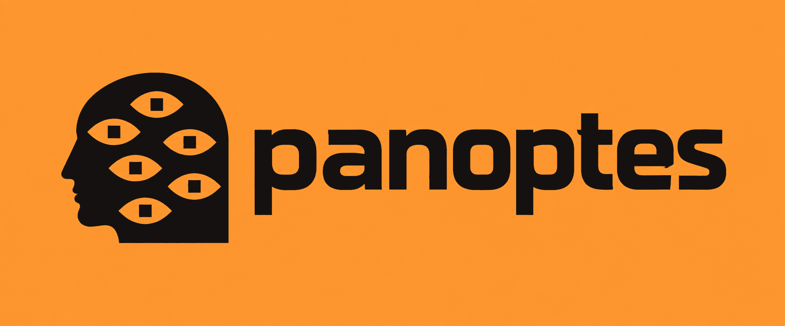
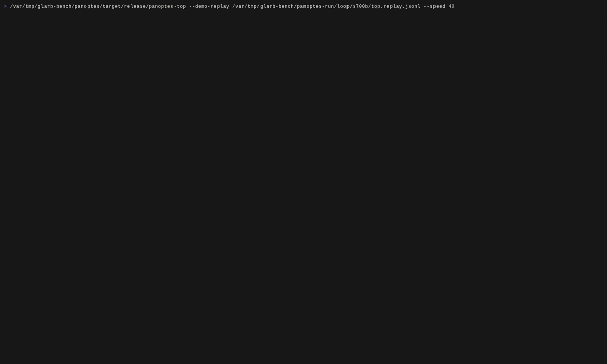

<p align="center">
  
</p>

Run hundreds of graphical AI agents on one Linux box.

Each agent gets its own desktop: a Cage compositor running Chromium.
While an agent waits for its model, Panoptes freezes its desktop with
cgroup v2. When the agent has been idle for a while, Panoptes compresses
the desktop's memory into zswap with writeback off. A parked desktop
holds about 40 MiB and takes about 100 ms to wake and take a screenshot.



`panoptes top` replaying the 700-agent test run at 40 times speed. Blue
boxes are parked desktops, orange ones are waiting for the model, and
green ones are acting. The model in this run is scripted; see Status.

`panoptes-desk` serves each agent's tools (screenshot, click, type, key,
scroll, navigate, accessibility tree) over MCP. `panoptes-loop` drives
many agents from one process with any OpenAI-compatible model API.

Status: prototype. On one host with 32 threads and 125 GiB of RAM, 700
agents entered 700 of 700 test invoices correctly, with 670 parked at the
peak. That run used a scripted model that answers from the test data, to
measure Panoptes itself; real models have run 10 invoices.
[docs/one-pager.md](docs/one-pager.md) has the numbers, and
[docs/design/](docs/design/README.md) explains how each was measured.

## Layout

```text
crates/
├─ panoptes          host command line: check the host, start and stop fleets
├─ panoptes-cgroup   cgroup v2: freeze, reclaim, weights, PSI, clone3 spawn
├─ panoptes-cdp      Chrome DevTools Protocol client over a pipe
├─ panoptes-desk     per-agent tool server: screenshot, input, tree; MCP
├─ panoptes-resd     freezes, parks, and evicts agents' desktops
├─ panoptes-loop     agent loop with an OpenAI-compatible model client
├─ panoptes-oracle   scripted model for scale tests
├─ panoptes-top      terminal view of every agent
└─ panoptesctl       command line
demo/                invoice-entry demo: generator, supplier portals, ERPNext
bench/               benchmark scripts E1 to E14 and their raw results
docs/                design notes and decisions
```

## Build

Needs Linux with cgroup v2 and kernel 6.8 or later.

```sh
nix develop
cargo build --release --workspace
cargo test --workspace
```

Parking needs zswap (zsmalloc and zstd) and swap large enough for the
parked desktops. [docs/design/decisions.md](docs/design/decisions.md)
lists the host settings.

## License

AGPL-3.0-or-later. See [LICENSE](LICENSE).
