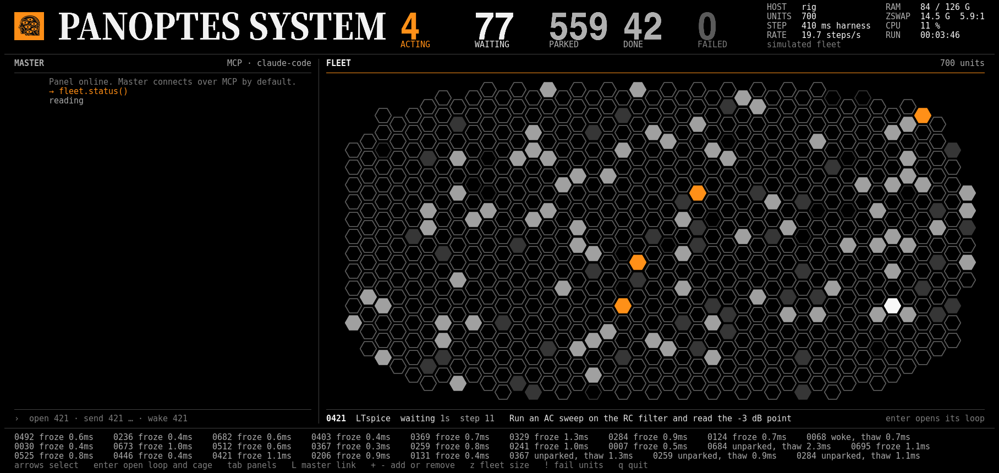
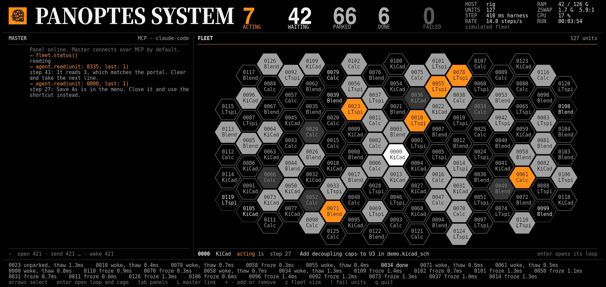
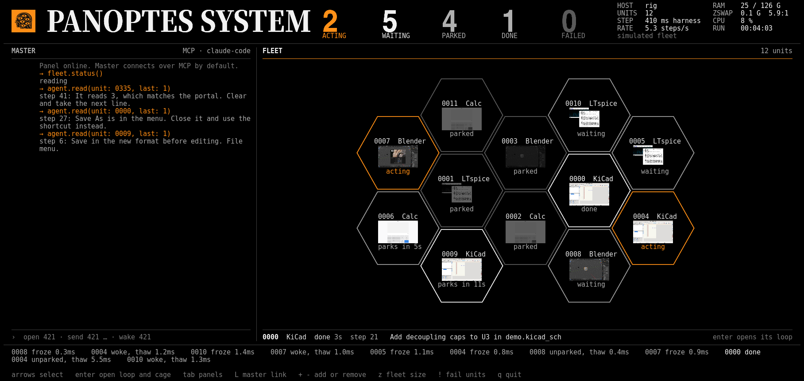
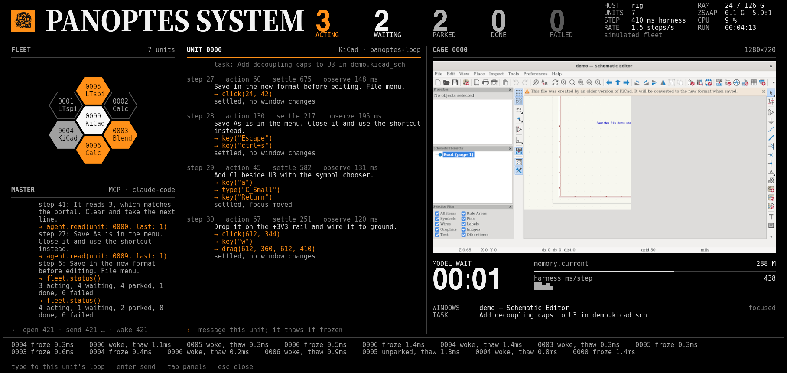

# Panoptes System: control panel mock

Status, 2026-11-01: design v1. The look is approved. No crate uses this yet.

`panoptes top` becomes a control panel called Panoptes System. It is a terminal
UI in its own Ghostty window, with one master agent and a hex grid of every
agent. Opening an agent shows its loop and its Cage side by side.

This folder mocks that panel in Node, so the design could change quickly. The
real panel stays in Rust and ratatui.

| 127 units | 12 units | One unit open |
|---|---|---|
|  |  |  |

The screenshots are from Ghostty 1.4.0 on Linux, in DejaVu Sans Mono.

## Run it

You need Nix, which fetches Ghostty and Node. This opens one window, on macOS or
Linux:

    ./run.sh

On Linux outside NixOS, Ghostty from Nix may not find the host's OpenGL drivers.
If no window opens, run its binary under a wrapper such as `nixGL`.

| Key | Action |
|---|---|
| arrows, `hjkl`, or click | Select a unit |
| `enter` | Open its loop and Cage |
| `esc` | Close it |
| `tab` | Move between panels |
| `m` | Type to the master |
| `z` | Cycle the fleet: 700, 127, 37, 12, 7 |
| `+` `-` | Add or remove one unit |
| `L` | Switch the master between MCP and its own loop |
| `!` | Fail some units |
| `q` | Quit |

## Only the captures are real

The fleet, transcripts, and host numbers are simulated, and the panel says so.
The screens are real 1280×720 captures of KiCad, Blender, Calc, and LTspice from
bench runs.

## The look follows urgency

- Black and white with one orange accent. Red means failure. The brighter a
  unit, the sooner it needs attention.
- The serif is only in the PANOPTES SYSTEM title. Numerals are Inter Bold. All
  other text is Menlo at 15 pt, or DejaVu Sans Mono on Linux.
- No Japanese and no retro effects. Thin rules instead of boxes.

## The unit count generates the grid

The largest hex size that holds every unit wins. Units take the positions
nearest the panel's centre, so the fleet is one solid block in the panel's shape.
Hex size decides what a hex shows:

| Hex height | Shows | Example |
|---|---|---|
| Under 4 rows | Color only | 700 units |
| 4 to 8 rows | ID and app | 127 units |
| 10 rows or more | Its real screen | 12 units |

Hexes are pixels, not glyphs: glyph hexes came out notched where two of them
shared a cell. Each look and size is one sprite, and each unit is one Kitty
placement below the text layer. A state change costs under 100 bytes at any fleet
size.

## Ghostty has two traps for the real panel

Both are read from the Ghostty 1.4.0 source, in
`src/terminal/kitty/graphics_storage.zig`. The first also reproduced in this mock.

- **`ESC[2J` frees every uploaded image that has no placement** (`clearScreen`).
  The title and captures vanished this way, with `ENOENT` errors in Ghostty's
  log. ratatui 0.29 sends this clear whenever a fullscreen viewport resizes. Use
  `Viewport::Fixed` instead, which clears with `ESC[0J`. That path is read, not
  run.
- **A placement with `c,r` subtracts its pixel offset from its size**
  (`pixelSize`). This squashed some hexes. Place pixel-offset sprites at native
  size.

## The loop move is the largest dependency

`panoptes-loop` cannot run on the current desk. It observes with `ax_tree` and
acts with `navigate` and `node_id`. The Wayland desk offers `screenshot`,
`windows`, `click`, and similar. Unit transcripts and messaging wait on this
move.

| In the mock | Source today | Still needed |
|---|---|---|
| Fleet states | resd `status` | Draw every agent, not only `pdesk-loop-N` |
| Counts, RAM, CPU | resd, `/proc` | Nothing |
| Harness ms, steps/s | Loop `trace.jsonl` | Nothing |
| zswap ratio | None found | Export it or drop it |
| `parks in Ns` | resd config | Add `park_after` to `status` |
| Screens in hexes | Desk `--thumb-ms`, at 1/10 size | Read every visible unit's thumbnail |
| Cage panel | Desk `screenshot` | Wire it up. Poll only live units, because a desk with `--resd` acquires the kiosk before each call |
| Unit transcript | `reply` and `results` in the trace | The loop on the Wayland desk |
| Message a unit | Nothing | An inbox and a socket in the loop |
| Master over MCP | Nothing; the desk already uses `rmcp` | Serve MCP from `panoptes-top` |
| Master's own loop | The loop takes only invoices | Generic tasks |

## Build order

| # | Slice | Needs | Proof |
|---|---|---|---|
| 1 | Panel shell: layout, hexes, title, launcher, every resd agent, `parks in Ns` | None | Layout tests over many unit counts; no `ENOENT` after a real resize; a run from Ghostty on a Mac over `ssh` |
| 2 | Cage view on open | 1 | Harness ms/step with a unit open and closed |
| 3 | Master over MCP, read-only | 1 | An MCP client connects, and its counts match resd |
| 4 | Loop on the Wayland desk | None | One real task finishes and shows in the unit pane |
| 5 | Loop inbox, typing to a unit, `agent.send` | 3, 4 | A message reaches the next step's prompt |
| 6 | Master's own loop | 3, 4 | The same panel, with the master running as a loop |

## Still open

- **Cage layout at 4:3.** The captures are 16:9, but the desk defaults to
  1024×768. A 4:3 screen is taller, so the Cage panel needs a new layout. The
  mock does not show this.
- **SSH.** Images go inline through the pty, which should work over `ssh`. This
  has not been run.
- **Who moves the loop.** Slice 4 has no owner yet.
